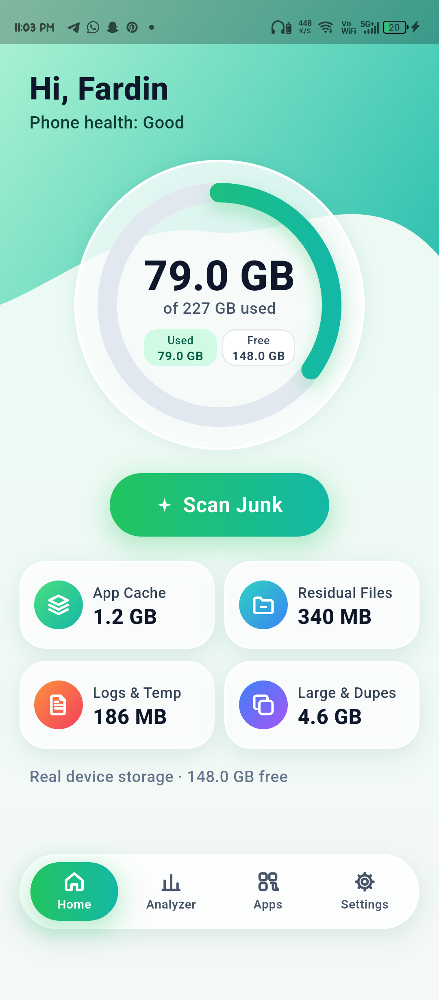
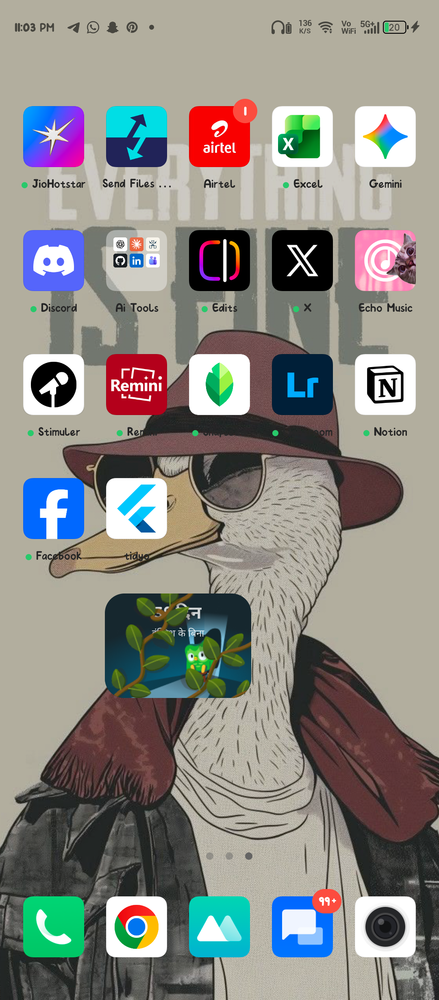

# Tidyo 🧹✨

> **The 100% Free & Open-Source, Cross-Platform Mobile Cleaner for Android & iOS.**  
> Zero Ads. Zero Telemetry. 100% Genuine Storage Recovery.

[](https://opensource.org/licenses/MIT)
[](https://flutter.dev)
[](https://dart.dev)
[](https://github.com/Fardin7798/Tidyo)
[](https://github.com/Fardin7798/Tidyo/pulls)

---

## 🌟 Why Tidyo?

Most mobile cleaner apps on app stores are filled with invasive fullscreen ads, sketchy background telemetry, and fake "boosting" animations that actually consume more RAM and battery than they save.

**Tidyo is built differently:**
- **100% Free & Open-Source:** Fully auditable code. No hidden backdoors, no user tracking.
- **Genuine Storage Engine:** Directly interfaces with real filesystem partitions (`StatFs`, POSIX directory streams). No simulated numbers.
- **Safe 3-Tier Quarantine:** Protects user documents, downloads, and camera photos from accidental deletion.
- **Zero Asset Bloat:** Built with custom vector renderers (`CustomPainter`) for sub-millisecond launch times and tiny APK footprint.
- **Cross-Platform Vision:** Engineered in Flutter for seamless execution across Android and iOS devices.

---
## 📸 Visual Showcase

| Storage Dashboard | App Cache Cleaner | Residual Files Hunter | Logs & Temp Explorer | Storage Analyzer |
| :---: | :---: | :---: | :---: | :---: |
|  |  |  |  |  |


## 📱 Core Features

### 1. Real-Time Storage Partition Telemetry
- Live storage progress ring tracking device partition metrics (`Used`, `Free`, `Total`) directly via `StatFs` and directory telemetry.
- Instant health evaluation and one-tap safe junk scanning.

### 2. Intelligent Junk Scanner & 3-Tier Safe Quarantine
- Live recursive directory scanner with real-time file counters, progress percentage, and path breadcrumbs.
- Detects app cache, orphan `.tmp` files, obsolete logs, and stale APK installers.
- **100% Safe:** Empty folders, app logs, temporary cache, old APK installers (auto-checked).
- **Review Required:** Messaging stickers, voice notes, screenshots (explicit user confirmation).
- **Protected:** Camera photos, downloads, system documents (permanently locked from accidental deletion).

### 3. App Cache Manager
- Instant inspection of heavy application caches (YouTube, Instagram, Chrome, Spotify, Google Maps).
- One-tap direct system intent launch to native Android App-Info screen for instantaneous cache clearing without permission risk.

### 4. Residual Files Hunter
- Scans `/Android/data`, `/Android/media`, and `/Android/obb` for leftover orphan folders of uninstalled applications.
- Visual breakdown of subdirectories (`cache`, `files`, `obb`) with one-tap safe purge.

### 5. Logs & Temporary Files Explorer
- Deep-dives into `.log`, `.tmp`, and crashdumps (`tombstones`, `anr`).
- In-app text preview of log files with real timestamps and memory size breakdown before deletion.

### 6. Deep Clean (Messaging & Social Media Cache)
- Dedicated WhatsApp media cleaner for sent videos, status cache, voice notes, and stickers.
- Telegram cache and web browser cache managers.

### 7. Storage Analyzer & Big Files Hunter
- Storage composition breakdown across categories.
- Big Files Hunter with custom threshold filters (`25 MB+`, `50 MB+`, `100 MB+`).
- Duplicate file review and space diagnostics.

### 8. Preferences & Safe Quarantine Settings
- Tab 4 customization for Safe 3-Tier Quarantine, auto-scan on low storage, and notification alerts.
- Open-source repository information and privacy whitelist options.

---

## 🛠️ Architecture

Tidyo is built with strict **Feature-First Clean Architecture** and **Modular Dependency Injection** (matching the Islamic Legacy production standard):

```text
lib/
├── App.dart                                      # Root MultiProvider & Global ErrorBoundary
├── Main.dart
├── Config/
│   └── Injection/
│       ├── InjectionContainer.dart               # Service locator orchestrator (GetIt)
│       └── Modules/                              # Modular feature injection files
│           ├── CoreInjection.dart
│           ├── DashboardInjection.dart
│           ├── JunkScannerInjection.dart
│           ├── StorageAnalyzerInjection.dart
│           ├── DeepCleanInjection.dart
│           ├── AppCacheInjection.dart
│           ├── ResidualFilesInjection.dart
│           ├── LogsTempInjection.dart
│           └── SettingsInjection.dart
├── Core/
│   ├── Constants/                                # App colors, metrics, and thresholds
│   ├── Error/                                    # Domain Failure envelopes & AppExceptions
│   ├── Models/                                   # Core storage and junk models
│   ├── Result/                                   # Functional Result pattern (fpdart Either)
│   ├── Services/                                 # PermissionService, StorageService, ScannerService
│   ├── Theme/                                    # AppTokens (Tk) design tokens
│   ├── UseCase/                                  # BaseUseCase contract
│   ├── Utils/                                    # AppLogger (Gated production logging)
│   └── Widgets/                                  # Canvas360, ErrorBoundary, BottomPillNav, SvgIcon
└── Features/
    ├── Dashboard/                                # Domain, Data, Presentation (DashboardScreen)
    ├── JunkScanner/                              # Domain, Data, Presentation (ScanningScreen, ResultsScreen)
    ├── StorageAnalyzer/                          # Domain, Data, Presentation (AnalyzerScreen)
    ├── DeepClean/                                # Domain, Data, Presentation (DeepCleanScreen)
    ├── AppCache/                                 # Domain, Data, Presentation (AppCacheScreen)
    ├── ResidualFiles/                            # Domain, Data, Presentation (ResidualFilesScreen)
    ├── LogsTemp/                                 # Domain, Data, Presentation (LogsTempScreen)
    ├── Settings/                                 # Domain, Data, Presentation (SettingsScreen)
    └── Shell/                                    # AppShell (Bottom navigation coordinator)
```

---

## 🚀 Getting Started

### Prerequisites
- Flutter SDK `^3.47.5`
- Dart SDK `^3.13.4`
- Android Studio / VS Code with Flutter extension
- JDK 17 (Temurin 17 recommended)

### Installation

1. **Clone the repository:**
   ```bash
   git clone https://github.com/Fardin7798/Tidyo.git
   cd Tidyo
   ```

2. **Install dependencies:**
   ```bash
   flutter pub get
   ```

3. **Run on connected device / emulator:**
   ```bash
   flutter run
   ```

---

## 🤝 Contributing

Contributions are welcome! Please feel free to submit a Pull Request or open an issue for bug reports and feature requests.

---

## 📄 License

Distributed under the MIT License. See `LICENSE` for more information.
